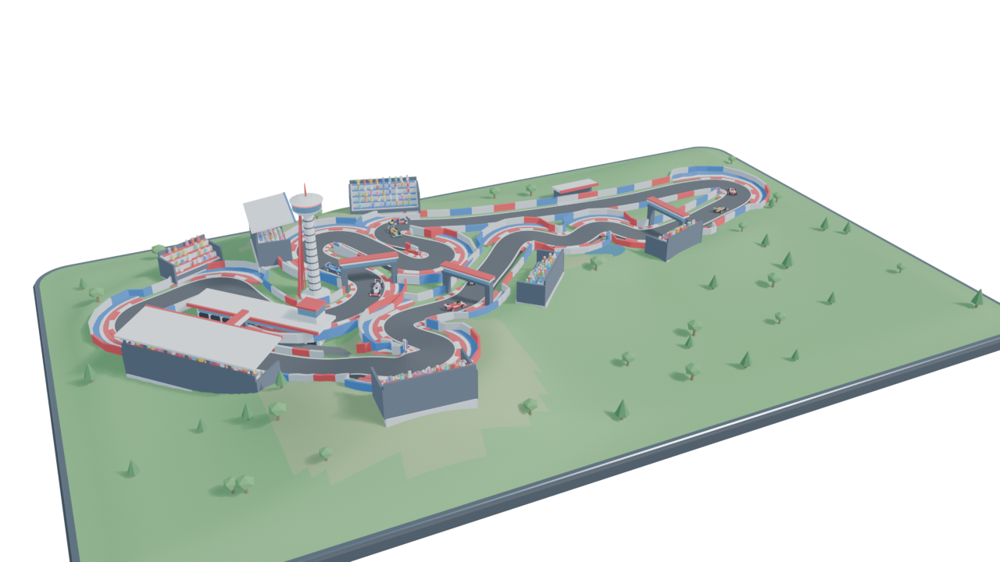

# F1 COTA Austin (Full-Scale) · Android & iOS Tabletop AR + Onboard View

An expanded, properly scaled 3D & Cross-Platform Tabletop AR build of **Circuit of the Americas (Austin, Texas)** crafted in Blender 5.2 LTS — upgraded with **2× wider racing roads**, **1.6× larger hero-scale Top 10 F1 cars**, generous Texas red/white/blue runoffs, grand proportionally scaled buildings & stands, and a **pure core glTF 2.0 4-material pipeline** engineered for **100% Android WebXR / ARCore Scene Viewer AND Apple iOS Quick Look compatibility**.

## What's Upgraded
- **Bigger Scale & Spacious Proportions (`1.76m × 1.08m` footprint, `4.38m` track)**:
  - **5.3 cm – 6.5 cm wide asphalt** (widening authentically into Turn 1's iconic braking zone) with zero hairpin creasing (`min_R = 3.65 cm`).
  - **4.5 cm long Hero-Scale F1 Cars** for the 2026 Top 10 grid (`#12 ANT`, `#3 VER`, `#63 RUS`, `#44 HAM`, `#16 LEC`, `#1 NOR`, `#81 PIA`, `#6 HAD`, `#30 LAW`, `#10 GAS`) with generous overtaking room (`>= 14.7 mm` collision-free clearance).
  - **Proportional Structures & Hills**: `11.2 cm` sweeping Turn 1 "Big Red" hill, `21.5 cm` red-veiled COTA Observation Tower inside a roomy Grand Plaza, `26.5 cm` Pit Building with 10 car-sized team garages & Race Control Tower, `26.5 cm` Main Grandstand, 6 additional stands (`Turn 1, 4, 9, 12, 15, 19`), ~260 cheering fans, 3 wide high-clearance pedestrian bridges, Germania Super Stage, and 40 Texas Hill Country trees.
- **Built for Android AND Apple AR**:
  - Audited **pure core glTF 2.0** (`extensionsUsed: None`, **4 PBR materials** using a packed 2.3 KB palette atlas, `< 50k` triangles, 1 unified 24s looping animation) so **Android Chrome WebXR** and **Google ARCore Scene Viewer (`com.google.ar.core`)** load seamlessly alongside **Apple iOS AR Quick Look** (`cota_austin_scaled.usdz`).
- **Onboard Car View, Chase Cam, Texas Skybox & Keyboard/Mouse**:
  - Click any of the 10 drivers (or press `1–0`) to ride onboard from their T-Cam or Chase Cam (`C`), toggle the procedural sunny **Texas Skybox** (`B`), or fly around freely with `WASD` + `Q/E` + mouse.
